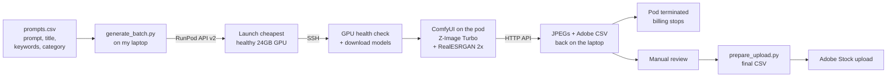

# AI Stock Image Pipeline

An automated, low-cost pipeline that rents a cloud GPU, generates commercially licensed AI images, upscales them, writes Adobe Stock metadata, and shuts the GPU down by itself.

I built this as a hands-on project to learn cloud GPU automation, API work and cost control, using a real end goal: submitting images to Adobe Stock.

> **Status:** working end to end. The first 18 curated images are in review with Adobe Stock.

---

## What it does



1. **Launches a GPU pod** through the RunPod REST API (v2), working through a preference list of 24GB+ GPUs.
2. **Checks the pod is healthy** over SSH: confirms the driver works and that PyTorch inside ComfyUI can actually use the GPU. Faulty pods are terminated and replaced automatically.
3. **Downloads the models** onto the pod (about 21 GB): Z-Image Turbo, its text encoder and VAE, plus a RealESRGAN upscaler.
4. **Generates every prompt** in `prompts.csv` through the ComfyUI HTTP API, with several variations per prompt.
5. **Upscales 2x on the GPU** (1920x1088 to 3840x2176, about 8.4 MP) and saves high-quality JPEGs with short, Adobe-safe filenames.
6. **Writes an Adobe Stock CSV** (Filename, Title, Keywords, Category, Releases) and a log of the prompt and seed behind every image.
7. **Terminates the pod, always**, even on errors, Ctrl+C or the time limit.

## Results

| | |
|---|---|
| Batch size | 20 prompts x 3 variations = 60 images |
| Run time | about 20 minutes on an RTX 4090, including startup and model download |
| Compute cost | well under US$1 per batch |
| Output | 3840x2176 JPEGs + upload-ready metadata CSV |
| Total project spend so far | about US$1.50 |

## Tech stack

- **Python 3.12**: `requests`, `paramiko` (SSH), `Pillow`, `python-dotenv`
- **RunPod**: on-demand GPU pods, REST API v2
- **ComfyUI**: image generation workflow, driven through its HTTP API
- **Models** (all licensed for commercial use):
  - [Z-Image Turbo](https://huggingface.co/Tongyi-MAI/Z-Image-Turbo) (Apache 2.0)
  - [RealESRGAN x2plus](https://github.com/xinntao/Real-ESRGAN) (BSD-3)

## Repository layout

```
.
├── generate_batch.py      # main pipeline: launch → generate → upscale → download → terminate
├── prepare_upload.py      # builds the final Adobe CSV from hand-picked images
├── prompts.csv            # prompt library with Adobe titles, keywords and categories
├── tools/
│   └── launch_test.py     # smoke test: launch a pod, check ComfyUI, terminate
├── requirements.txt
├── .env.example           # template for your API key (the real .env is git-ignored)
└── .gitignore             # keeps secrets, the virtual environment and outputs out of git
```

## Setup

**Requirements:** Python 3.12, a [RunPod](https://www.runpod.io) account with a few dollars of credit, and an SSH key.

```powershell
# 1. Clone and create a virtual environment
git clone https://github.com/Rahul12257318/ai-stock-image-pipeline.git
cd ai-stock-image-pipeline
python -m venv .venv
.\.venv\Scripts\Activate.ps1          # macOS/Linux: source .venv/bin/activate
pip install -r requirements.txt

# 2. Add your RunPod API key
copy .env.example .env                # then edit .env and paste your key

# 3. Create an SSH key just for the pods
ssh-keygen -t ed25519 -f "$HOME\.ssh\runpod_lumen" -C "runpod"
```

**RunPod API key permissions (least privilege):** REST API only. Pods read/write, Catalog read, Templates read, Account read. GraphQL: none. Serverless: none.

## Usage

```powershell
python tools/launch_test.py     # optional: prove you can launch and terminate a pod (a few cents)
python generate_batch.py        # run a full batch
```

Then review the images in `output/<date-time>/`, copy the keepers into `output/Final selected/`, and run:

```powershell
python prepare_upload.py
```

It writes `adobe_upload_FINAL_<date-time>.csv` and tells you, for each image, whether to submit it as a Photo or an Illustration and whether to tick "People and Property are fictional". Upload the JPEGs and the CSV in the Adobe Stock contributor portal, and tick **"Created using generative AI tools"** on every file.

## Safety and cost controls

- **Always terminates.** The pod is deleted in a `finally` block, with retries.
- **Hard runtime cap.** `MAX_RUNTIME_MIN` stops everything after a set time.
- **Fails fast.** A PyTorch GPU test runs within about a minute of connecting; broken pods are replaced before any large download.
- **Stops broken runs.** Several failed images in a row end the batch early.
- **Prepaid credit with auto-pay off**, so the worst case is capped at the loaded balance.
- **Secrets stay local.** API key in `.env`, SSH key in `~/.ssh`, both excluded from git.

## What I learned

- **The model decides quality, not the GPU.** Moving from SDXL to a newer model fixed most of the warped panels, missing turbine blades and garbled text. The GPU only changes speed.
- **Prompts should avoid AI weak spots.** Text and numbers, long rows of repeating objects and precise mechanical joins fail often. Close-ups with shallow depth of field and simple compositions work far better.
- **Cloud hosts fail.** Some pods crashed with `CUDA unknown error`. A quick health check plus automatic replacement turned that from a stuck run into a one-minute retry.
- **APIs change.** RunPod retired REST API v1 in November 2026, so the pipeline uses v2.
- **Least privilege matters, even on a side project.** The API key only has the permissions the script needs.
- **Read the licence of every model.** Some popular open models are non-commercial; everything here allows commercial use.

## Roadmap

- [ ] Track Adobe acceptance and rejection reasons and feed them back into the prompts
- [ ] Optional quality mode using the full Z-Image base model
- [ ] Automatic first-pass quality filter with a vision model
- [ ] Scheduled weekly batch runs

## Disclaimer

This is a personal learning project. Check the licence of any model you use and follow the [Adobe Stock generative AI guidelines](https://helpx.adobe.com/stock/contributor/submit-your-content/submit-generative-ai-content/generative-ai-content-guidelines.html) before submitting content.

## License

[MIT](LICENSE)
